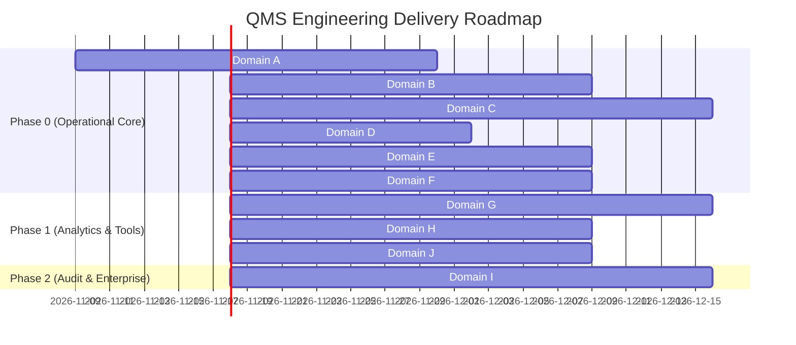

# Product Requirements Document — Quality Management System (QMS)

> **Status:** `PLANNING` — Enterprise Quality Governance & Control System Blueprint (v1.0)  
> **Standard Compliance:** ISO 9001:2015, IATF 16949:2016, VDA 6.3, AIAG-VDA FMEA, 21 CFR Part 11  
> **Manufacturing Domain:** Automotive Plastic Injection Molding & Discrete Assembly  
> **Companion Systems:** MES (`Manufacturing-Execution-System`), WMS (`Warehouse-Management-System`), MMS, ERP

---

## 1. Product Vision

### Elevator Pitch

The Quality Management System (QMS) is an enterprise-grade quality governance, inspection, and compliance platform designed specifically for precision automotive plastic injection molding plants. It orchestrates the end-to-end quality lifecycle—from APQP quality planning and incoming material inspection (IQC) to in-process injection monitoring (IPQC), non-conformance containment (NCR), 8D corrective actions (CAPA), statistical process control (SPC), audit governance, and measurement system analysis (MSA)—serving as the authoritative decision owner for product, material, and process release across the enterprise.

### Problem Statement

Tier 1 and Tier 2 automotive injection molding facilities face severe compliance, financial, and operational risks due to disconnected quality practices:

1. **Passive QC "Silo Recording" vs Active Quality Governance:** Traditional QC software functions merely as a digital logbook for inspection results after defects have already occurred, rather than an active quality gate that deterministically stops production lines or locks warehouse inventories.
2. **Quality Hold Bypasses & Traceability Breaches:** Under production pressure, material lots with unverified Certificates of Analysis (CoA) or high moisture content are inadvertently loaded into machine hoppers, resulting in massive scrap runs (e.g. splay, silver streaks, structural brittleness) and costly customer recalls.
3. **Disconnected First-Piece Approval & Process Drift:** Machine operators begin serial production before Quality Engineers have verified critical dimensions (CMM) and resin cushion limits, violating IATF 16949 requirements and leading to out-of-tolerance batches.
4. **Ineffective Problem Solving & Recurring Defects:** Non-conformance reports (NCRs) lack structured containment, resulting in repeat defects (e.g., short shots, sink marks) because root-cause investigations (5-Why, Fishbone) and CAPA verification of effectiveness (VoE) are untracked.
5. **Measurement Inaccuracy & Calibration Gaps:** Production decisions are frequently made using uncalibrated digital calipers, torque wrenches, or moisture analyzers with unknown Gauge R&R variability, compromising statistical validity.

---

### Target Users & Organizational Roles

In accordance with automotive IATF 16949 governance, the QMS is operated exclusively by the **Quality Assurance & Quality Control (QA/QC) Department**, with strict separation between inspection execution, verification, and disposition authority.

| Role | Department | Scope | Primary Needs & Responsibilities |
| :--- | :--- | :--- | :--- |
| **Quality Director / VP** | Quality Assurance | `ENTERPRISE` | Enterprise quality KPIs (PPM, Cost of Poor Quality / CoPQ), customer audit compliance, IATF certification oversight, and global CAPA governance. |
| **Quality Manager** | Quality Assurance | `PLANT` | Plant quality strategy, overseeing inspection throughput, approving high-risk NCR dispositions (Use-As-Is, Scrap > $10k), and customer escalation management. |
| **Quality Assurance Supervisor** | QA / Compliance | `PLANT` / `AREA` | Daily shift supervision, allocating inspectors across IQC/IPQC/OQC, reviewing inspection sample records, and tracking open containment actions. |
| **Quality Engineer (QE)** | Quality Engineering | `AREA` / `PRODUCT` | Authoring Control Plans, establishing CTQ tolerances, leading 8D Root Cause Analysis (RCA), managing CAPA workflows, and monitoring real-time SPC $C_{pk}$ trends. |
| **IQC Inspector** | Quality Control | `WAREHOUSE / DOCK` | Inspecting incoming raw resins (PP, ABS, PC) and masterbatches, validating supplier CoAs, recording moisture/MFI tests, and asserting Pass/Reject status. |
| **IPQC Inspector** | Quality Control | `SHOP FLOOR` | Conducting First-Piece Inspections (FAI), running hourly patrol rounds across injection machines, logging visual/dimensional defects, and issuing line stops. |
| **OQC / Final Inspector** | Quality Control | `PACKAGING / FG` | Final CMM checks, packaging integrity audits, cosmetic acceptance sampling (AQL/c=0), and issuing formal Quality Clearance / CoC for shipment. |
| **Metrologist / Tool Custodian** | Quality Engineering | `METROLOGY LAB` | Managing gauge master data, executing calibration routines, tracking certificate expiration, and conducting MSA (Gauge R&R, ANOVA). |
| **Document Controller** | Quality Assurance | `PLANT` | Administering Quality Manual, SOPs, Control Plans, and Work Instructions under strict 21 CFR Part 11 revision control and distribution workflows. |
| **Lead Quality Auditor** | QA / Compliance | `PLANT` / `SUPPLIER` | Planning and conducting internal audits (IATF 16949 / ISO 9001), process audits (VDA 6.3), supplier audits, and tracking audit finding remediations. |

---

## 2. System Boundaries & Enterprise Integration Topology

The QMS does not replace or duplicate ERP, MES, WMS, or MMS. Instead, it acts as the **Authoritative Quality Decision Owner** across the enterprise stack:

```
┌─────────────────────────────────────────────────────────────────────────────────┐
│                                 ERP (Level 4)                                   │
│            • Master Supplier & POs          • Customer Sales Orders & Shipments │
│            • Material / SKU Master          • Cost of Poor Quality (CoPQ)       │
└───────────────▲─────────────────────────────────────────────────▲───────────────┘
                │ (Supplier, PO, SKU Sync)                        │ (IQC & OQC Status)
                ▼                                                 ▼
┌─────────────────────────────────────────────────────────────────────────────────┐
│                                 QMS (Level 3/4)                                 │
│  Quality Planning │ IQC │ IPQC │ OQC │ NCR │ CAPA │ SPC │ Doc Control │ Audit │ MSA │
│                       [AUTHORITATIVE QUALITY DECISION OWNER]                   │
└───────▲───────────────────────────────▲─────────────────────────────────▲───────┘
        │ (Incoming Lot, Quarantine)    │ (Run, Telemetry, Defect Events) │ (Calibration, PM)
        ▼                               ▼                                 ▼
┌──────────────────────┐    ┌──────────────────────┐    ┌──────────────────────┐
│     WMS (Level 3)    │    │     MES (Level 3)    │    │     MMS (Level 3)    │
│ • Raw & FG Storage   │    │ • Shopfloor Execution│    │ • Machine Tooling    │
│ • Bin Movements      │    │ • Machine Telemetry  │    │ • Mold Preventive PM │
│ • Physical Staging   │    │ • Production Runs    │    │ • Breakdown Repairs  │
│ • Shipping Docks     │    │ • Digital Travelers  │    │ • Mold Shot Counts   │
└──────────────────────┘    └──────────────────────┘    └──────────────────────┘
```

### Responsibility & Data Ownership Matrix

| Dimension | ERP | MES | WMS | QMS | MMS |
| :--- | :--- | :--- | :--- | :--- | :--- |
| **Core Responsibility** | Commercial, procurement, finance, costing | Production execution, shopfloor tracking, OEE | Inventory balances, bin movements, logistics | Quality standards, inspections, NCR, CAPA, quality disposition | Machine/tooling reliability, PM schedules, repair jobs |
| **Physical Context** | Ledger & enterprise business units | 10 Injection Molding Machines (`IMM-01` to `10`) | Racks, Silos, Staging Hoppers (`STG-IMM-xx`) | Metrology lab, IQC dock, inspection stations | Machine platens, hydraulic pumps, mold cores/cavities |
| **Data Produced** | Purchase Orders, Sales Orders, Supplier IDs | Part output counts, cycle times, raw scrap | Bin occupancy, picked pallets, delivery orders | Inspection results, NCRs, 8D actions, Cpk values | Work orders, maintenance checklists, downtime root causes |
| **Quality Authority** | Acknowledges financial invoice hold | Enforces line stop & run lock upon reject | Blocks bin picking & staging upon QA_HOLD | **Makes and signs the quality disposition decision** | Locks tool from mounting if overdue for service |

---

## 3. Scope: The 10 Functional Domains

The QMS architecture is structured into 10 cohesive functional domains divided into development priority phases:
- **Phase 0 (P0 - Operational Foundation):** Domains A, B, C, D, E, F
- **Phase 1 (P1 - Analytics & Engineering):** Domains G, H, J
- **Phase 2 (P2 - Auditing & Ecosystem):** Domain I

```
┌──────────────────────────────────────────────────────────────────────────────────┐
│                             QMS 10 FUNCTIONAL DOMAINS                            │
├────────────────────────────┬─────────────────────────────┬───────────────────────┤
│ P0: Operational Core       │ P1: Performance & Control   │ P2: Governance        │
│ • A. Quality Planning      │ • G. Statistical Control    │ • I. Quality Audit    │
│ • B. Incoming QC (IQC)     │ • H. Document Control       │                       │
│ • C. In-Process QC (IPQC)  │ • J. Equipment & Gauge MSA  │                       │
│ • D. Outgoing QC (OQC)     │                             │                       │
│ • E. Non-Conformance (NCR) │                             │                       │
│ • F. Corrective Action     │                             │                       │
└────────────────────────────┴─────────────────────────────┴───────────────────────┘
```

---

### Domain A: Quality Planning & Standards (P0)

*Manages the foundation of quality criteria, engineering specifications, inspection plans, and control plans under IATF 16949 / ISO 9001 guidelines.*

- **Quality Plans & Control Plans:** Links part numbers (`PRD-AUTO-BUMPER`, `PRD-DOOR-TRIM`, `PRD-HVAC-DUCT`) and material codes (`RES-PP-HOMO`, `RES-ABS-HI`) to approved Control Plans derived from PFMEA.
- **Characteristics & Specifications:** Defines Variable characteristics (target, USL, LSL, engineering units, e.g., wall thickness $3.2 \pm 0.2\text{ mm}$, critical width $1450 \pm 2\text{ mm}$) and Attribute characteristics (pass/fail visual criteria, e.g., flash, sink marks, bubble defects).
- **Sampling Regimes:** Configures inspection frequencies (First Piece, 100% sorting, hourly patrol, 1 sample per 500 shots, skip-lot rules) and sampling plans (ISO 2859-1 / ANSI/ASQ Z1.4 Normal, Tightened, Reduced; c=0 plans).
- **Revision Control & ECN:** Enforces strict engineering revision tracking (`REV-A`, `REV-B`) synchronized with PLM; updates to an inspection plan require engineering sign-off before taking effect on the shop floor.

---

### Domain B: Incoming Quality Control — IQC (P0)

*Validates raw resins, masterbatches, regrind materials, and packaging supplies prior to warehouse putaway or shopfloor staging.*

- **Shipment Intake Trigger:** Receives automated event notification from WMS upon physical receipt at the unloading dock (`wms.shipment_received`).
- **Certificate of Analysis (CoA) Verification:** Evaluates supplier lot CoAs against raw resin grade specifications (Melt Flow Index, Density, Moisture %, Ash content). Automates CoA parsing and flag checks.
- **Physical Sampling & Testing:** Prompts IQC inspector with digital test forms based on material category (`BASE_RESIN`, `MASTERBATCH`, `PACKAGING`):
  - Polymer Moisture Analysis (e.g. moisture analyzer max $0.02\%$ for ABS/PC).
  - Density and Melt Flow Index (MFI) laboratory verification.
  - Granule visual cleanliness and color pellet contamination test.
- **Disposition & Automated WMS State Machine:**
  - Status transitions: `PENDING_INSPECTION` $\rightarrow$ `ACCEPTED` | `REJECTED` | `CONDITIONAL_APPROVAL`.
  - Upon `ACCEPTED`: QMS broadcasts `qms.lot_released`; WMS automatically releases the lot from `QA_HOLD` to `AVAILABLE` rack storage.
  - Upon `REJECTED`: QMS generates a **Supplier NCR (SNCR)** and instructs WMS to flag the lot as `QUARANTINE` and generate physical red barcoded hold tags.
- **Supplier Performance Tracking:** Records lot acceptance rate, CoA compliance rate, and defective PPM by supplier (`VEND-LOTTE`, `VEND-INEOS`, `VEND-CLARIANT`).

---

### Domain C: In-Process Quality Control — IPQC (P0)

*Enforces quality gates during injection molding serial production, eliminating process drift and defect propagation.*

- **Hard First-Piece Inspection (FAI) Gating:**
  - Following mold setup, resin changeover, or maintenance restart on any of the 10 injection molding machines (`IMM-01` to `10`), the MES production run is automatically locked in `SETUP / WAITING_QC` state.
  - The IPQC Inspector performs dimensional CMM checks, weight measurements, and cosmetic inspection of the first shot parts.
  - QMS sends signed digital authorization (`POST /api/v1/integration/qms/qc-release`) to MES to unlock the line into `RUNNING` state. Production cannot run without this cryptographic release.
- **Hourly Patrol Inspection Rounds:**
  - System generates automated patrol inspection prompts every 60 minutes for active production runs.
  - Inspector records variable measurements (gate vestige height, wall thickness) and attribute checks.
- **Machine Process Envelope Verification:**
  - Pulls real-time injection telemetry from MES/OPC UA edge gateways (barrel zone temperatures, injection peak pressure, holding pressure, cushion position).
  - Alerts when actual process parameters drift beyond approved PLM recipe tolerance windows.
- **Line Defect Logging:**
  - Records localized defects: *Short Shot, Flash / Burrs, Sink Marks, Silver Streaks / Splay, Warpage, Burn Marks, Jetting, Weld Lines*.
  - Automatically calculates real-time shift scrap percentage; triggers immediate line-stop Andon if defect rate exceeds $2.5\%$.

---

### Domain D: Outgoing Quality Control — OQC (P0)

*Final verification of molded automotive parts and packaged cartons prior to customer dispatch.*

- **Packaging Audit & Inspection:** Validates finished goods packaging units against customer packaging specifications (corrugated carton integrity, desiccant placement, ESD bag sealing, label clarity).
- **Sampling Inspection:** Executes final audit based on ISO 2859-1 Level II normal inspection ($c=0$ sampling plan).
- **Barcode & Traceability Verification:** Scans carton barcodes (e.g. `PKG-AUTO-BUMPER-001`) and cross-checks with MES Digital Traveler and material lot genealogy tree to ensure all components were produced under nominal control parameters.
- **Quality Clearance (Release for Shipment):** Generates electronic Certificate of Conformance (CoC); pushes clearance status to WMS. Un-cleared cartons are physically and digitally blocked from being assigned to outbound Delivery Orders (DO).

---

### Domain E: Non-Conformance Management — NCR (P0)

*Standardized containment, root cause tagging, and disposition workflows for non-conforming materials and products.*

- **Omni-Channel NCR Generation:** Can be initiated from IQC (incoming material defect), IPQC (shopfloor line defect), OQC (final audit defect), or Customer Complaint / RMA.
- **Defect Severity Classification:** Categorizes severity: *Critical (Safety/Regulatory/Fit-Function breach)*, *Major (Assembly line-stop / rework required)*, *Minor (Cosmetic anomaly within concession limit)*.
- **Automated Quarantine & Quality Hold Propagation:**
  - Instantly issues multi-system hold: instructs WMS to lock corresponding material lots or finished goods bins into `QUARANTINE / QA_HOLD`, and instructs MES to halt runs utilizing the affected lot.
  - Generates serial quarantine hold placards with QR codes.
- **Multi-Level Disposition Workflows:**
  - **Rework:** Routes parts to secondary finishing with rework instructions; requires re-inspection before release.
  - **Scrap:** Authorizes physical scrapping; updates MES scrap ledger and triggers ERP financial write-off.
  - **Return to Vendor (RTV):** Routes material to warehouse shipping bay with Supplier NCR.
  - **Use-As-Is (Concession):** Requires dual approval from Quality Manager, Chief Engineer, and Customer Quality Representative (CSR).

---

### Domain F: Corrective and Preventive Action — CAPA (P0)

*Structured 8D problem-solving methodology preventing defect recurrence and enforcing operational excellence.*

- **Automated CAPA Escalation:** Automatically triggers a formal 8D CAPA workflow when:
  - Any *Critical* severity NCR is registered.
  - Repeat defects occur more than 3 times within 30 days on the same machine/mold/part.
  - Defect PPM exceeds target threshold.
  - External customer complaint (Customer RMA / 0-km defect) is received.
- **Standardized 8D Problem Solving Lifecycle:**
  - **D1: Team Formation:** Appoints Champion, Leader, and cross-functional members (QA, Production, Tooling, Maintenance).
  - **D2: Problem Description:** Structured 5W2H (What, Where, When, Who, Why, How, How Many) and Is/Is Not matrix.
  - **D3: Interim Containment Actions (ICA):** Containment at customer warehouse, in-transit, plant inventory, and raw stock; verifies $100\%$ containment effectiveness.
  - **D4: Root Cause Analysis (RCA):** Mandatory 5-Why analysis and Ishikawa (Fishbone) diagram covering Man, Machine, Material, Method, Measurement, Environment. Distinguishes *Root Cause of Occurrence* from *Root Cause of Escape*.
  - **D5: Permanent Corrective Actions (PCA):** Defines poka-yoke (mistake-proofing), process parameter fixes, or mold revisions.
  - **D6: Implement & Validate PCA:** Tracks engineering change execution and runs validation trials.
  - **D7: Prevent Recurrence:** Updates PFMEA, Control Plans, SOPs, and training records.
  - **D8: Congratulate Team & Closure:** Formal review by Quality Manager.
- **Verification of Effectiveness (VoE):** Tracks recurrence-free operation over 30, 60, and 90 days before final administrative closure.

---

### Domain G: Statistical Process Control — SPC (P1)

*Real-time mathematical process monitoring, capability assessment, and predictive out-of-control detection.*

- **Control Charts:**
  - Variable Charts: $\bar{X}-R$ (Subgroup size 2–9), $\bar{X}-s$ (Subgroup size $\ge 10$), Individual & Moving Range ($I-MR$).
  - Attribute Charts: $p$-chart (fraction defective), $np$-chart, $c$-chart, $u$-chart.
- **Automated Rule Violation Detection:** Real-time evaluation against Western Electric & Nelson Rules:
  - Rule 1: 1 point beyond Zone A ($> 3\sigma$).
  - Rule 2: 9 points in a row on one side of center line.
  - Rule 3: 6 points in a row continuously increasing or decreasing (trend).
  - Rule 4: 14 points alternating up and down.
  - Rule 5: 2 out of 3 points in Zone A or beyond ($> 2\sigma$).
- **Process Capability Indices:** Automatically calculates $C_p$, $C_{pk}$, $P_p$, $P_{pk}$, and estimated PPM against automotive minimum capability requirements ($C_{pk} \ge 1.33$ standard, $C_{pk} \ge 1.67$ for critical safety dimensions).
- **Pareto & Trend Analytics:** Visual loss breakdown by defect type, machine cell, mold cavity, and shift.

---

### Domain H: Document & Change Control (P1)

*21 CFR Part 11 compliant digital repository ensuring operators and inspectors always work against approved, uncorrupted standards.*

- **Controlled Document Repository:** Quality Manual, Standard Operating Procedures (SOPs), Work Instructions, Visual Inspection Standards, Packaging Specifications, and Control Plans.
- **Lifecycle & Approval Matrix:** States: `DRAFT` $\rightarrow$ `UNDER_REVIEW` $\rightarrow$ `APPROVED` $\rightarrow$ `RELEASED` $\rightarrow$ `OBSOLETE`. Enforces dual digital signature approval (e.g., Quality Engineer + Quality Manager).
- **Distribution & Obsoletion Governance:** When a new revision is released, older revisions are automatically archived and revoked from floor terminals; forces operator digital acknowledgment of revised work instructions upon shift login.

---

### Domain I: Audit Management (P2)

*Systematic planning, execution, and finding tracking for internal, process, product, and supplier quality audits.*

- **Audit Programs & Calendars:** Annual scheduling for Internal Audits, Supplier Audits, VDA 6.3 Process Audits, and Layered Process Audits (LPA).
- **Standardized Checklists:** Built-in checklists mapped clause-by-clause to IATF 16949:2016, ISO 9001:2015, and customer-specific requirements (CSR).
- **Finding Management:** Records non-conformances classified into Major NC, Minor NC, and Opportunity for Improvement (OFI). Automatically links findings to CAPA workflows with mandatory 30-day resolution SLAs.

---

### Domain J: Equipment, Measurement & Gauge MSA (P1)

*Maintains metrological traceability, automated calibration lockout, and Measurement System Analysis under AIAG MSA 4th Edition.*

- **Gauge Master Registry:** Master database of measurement devices (digital calipers, outside micrometers, pin gauges, height gauges, CMM probes, melt flow indexers, moisture analyzers, torque wrenches).
- **Calibration Status Lifecycle:** `CALIBRATED`, `CALIBRATION_DUE` (within 14 days), `OVERDUE`, `OUT_OF_SERVICE`.
- **Automated Measurement Lockout:** QMS strictly blocks recording inspection values using any gauge with `OVERDUE` or `OUT_OF_SERVICE` status.
- **Measurement System Analysis (MSA):**
  - **Gauge R&R (Variable):** ANOVA and $\bar{X}-R$ methods calculating Equipment Variation ($EV / \text{Repeatability}$), Appraiser Variation ($AV / \text{Reproducibility}$), and $\%R\&R$. Enforces AIAG acceptance criteria: $\%R\&R < 10\%$ (Acceptable), $10\% - 30\%$ (Conditionally acceptable), $> 30\%$ (Unacceptable).
  - **Attribute Agreement Analysis:** Kappa statistics ($\kappa$) assessing cross-appraiser and standard consistency for visual defect inspectors.

---

## 4. User Stories / Use Cases

### Epic 1: Quality Planning & Control Plans (P0)

| ID | User Story | Priority | Acceptance Criteria |
| :--- | :--- | :---: | :--- |
| `US-QP-001` | As a **Quality Engineer**, I want to create a versioned Control Plan for part `PRD-AUTO-BUMPER` linking drawing dimensions to inspection methods so that inspectors follow certified IATF standards. | `P0` | System allows adding variable and attribute characteristics with USL, LSL, target, tool type, sample frequency, and inspection stage; requires QA Manager approval before release. |
| `US-QP-002` | As a **Quality Engineer**, I want to update an Inspection Plan to `REV-B` when an Engineering Change Notice (ECN) arrives so that obsolete tolerances cannot be inspected. | `P0` | System archives `REV-A`, marks it obsolete, mandates change notes, and automatically propagates `REV-B` to active shopfloor inspection terminals. |

### Epic 2: Incoming Quality Control — IQC (P0)

| ID | User Story | Priority | Acceptance Criteria |
| :--- | :--- | :---: | :--- |
| `US-IQC-001` | As an **IQC Inspector**, I want to scan incoming resin bags of `RES-ABS-HI` and evaluate the supplier's CoA so that non-compliant chemical grades are rejected at the dock. | `P0` | System verifies moisture $\le 0.02\%$ and MFI within $18 \pm 2\text{ g/10min}$; if out of tolerance, blocks acceptance and flags lot as `QA_HOLD`. |
| `US-IQC-002` | As a **Warehouse Handler**, I want the WMS to automatically update lot status to `AVAILABLE` when IQC marks a lot `ACCEPTED` so that I can stage it to machines without manual paperwork. | `P0` | QMS emits `qms.lot_released` webhook; WMS ledger records movement from QC Cage to Available RM storage within $< 1\text{ second}$. |
| `US-IQC-003` | As an **IQC Inspector**, I want to reject a damaged masterbatch lot and create an automated Supplier NCR so that purchasing can withhold supplier payment. | `P0` | System generates SNCR record, attaches photo evidence, updates WMS lot status to `QUARANTINE`, and dispatches notification to ERP / Purchasing. |

### Epic 3: In-Process Quality Control & First-Piece Gating — IPQC (P0)

| ID | User Story | Priority | Acceptance Criteria |
| :--- | :--- | :---: | :--- |
| `US-IPQC-001` | As an **IPQC Inspector**, I want to perform a First-Piece Inspection (FAI) on `IMM-01` after mold setup and submit my sign-off so that the machine can begin serial production. | `P0` | QMS validates all 4 cavity samples pass tolerance; calls MES `POST /api/v1/integration/qms/qc-release`; MES run transitions from `SETUP` to `RUNNING`. |
| `US-IPQC-002` | As a **Machine Operator**, I want the MES to refuse starting production runs if First-Piece QC is missing so that unapproved parts are never produced. | `P0` | MES displays hard error and disallows starting run until cryptographic QMS release token is received. |
| `US-IPQC-003` | As an **IPQC Inspector**, I want to conduct hourly patrol inspections and log defect counts (sink marks, flash) so that trends are visible in real time. | `P0` | System accepts dimensional values and defect counts; if defect count $> 2.5\%$, system triggers an Andon alert and prompts for immediate line intervention. |

### Epic 4: Non-Conformance & Containment — NCR (P0)

| ID | User Story | Priority | Acceptance Criteria |
| :--- | :--- | :---: | :--- |
| `US-NCR-001` | As a **Quality Supervisor**, I want to declare a Quality Hold on raw lot `LOT-PP-202610-01` so that both warehouse and production lines immediately cease using the affected material. | `P0` | QMS updates lot status to `QA_HOLD`; WMS blocks bin picking; MES `loadHopper` throws `BadRequestException` when operator attempts to load the lot into any machine. |
| `US-NCR-002` | As a **Quality Manager**, I want to disposition an NCR as `REWORK` with specific trimming work instructions so that parts can be rectified and re-inspected. | `P0` | Generates secondary work order; tracks re-inspection pass rate before final inventory release. |

### Epic 5: Corrective and Preventive Action — CAPA (P0)

| ID | User Story | Priority | Acceptance Criteria |
| :--- | :--- | :---: | :--- |
| `US-CAPA-001` | As a **Quality Engineer**, I want to initiate an 8D CAPA for recurring short shot defects on mold `MOLD-BUMP-2C` so that root causes are systematically eliminated. | `P0` | System provides 8D workflow wizard (D1 to D8), requires completed 5-Why analysis and Fishbone diagram before allowing advancement to PCA implementation. |
| `US-CAPA-002` | As a **Quality Manager**, I want to track 30-day and 60-day Verification of Effectiveness (VoE) before closing a CAPA so that solutions are proven permanent. | `P0` | System maintains CAPA in `MONITORING` state; confirms 0 repeat defects of the same classification over the evaluation window prior to administrative closure. |

### Epic 6: Statistical Process Control & Analytics — SPC (P1)

| ID | User Story | Priority | Acceptance Criteria |
| :--- | :--- | :---: | :--- |
| `US-SPC-001` | As a **Quality Engineer**, I want real-time $\bar{X}-R$ control charts for critical bumper width ($1450 \pm 2\text{ mm}$) so that I can detect tool wear before parts fall out of spec. | `P1` | Plots subgroup means and ranges; calculates UCL and LCL dynamically; visually highlights Western Electric rule breaches within 500ms of sample entry. |
| `US-SPC-002` | As an **Operations Manager**, I want automated monthly $C_{pk}$ capability reports for all automotive parts so that I can provide compliance evidence to OEM customers. | `P1` | Computes $C_p, C_{pk}, P_{pk}$; flags any process where $C_{pk} < 1.33$ with required engineering action items. |

### Epic 7: Equipment Calibration & Gauge MSA (P1)

| ID | User Story | Priority | Acceptance Criteria |
| :--- | :--- | :---: | :--- |
| `US-MSA-001` | As an **Inspector**, I want the system to block me from recording measurements with a caliper whose calibration is expired so that inspection integrity is never compromised. | `P1` | System validates gauge ID; if `status === 'OVERDUE'`, displays red modal warning and disables input fields. |
| `US-MSA-002` | As a **Quality Engineer**, I want to conduct a 10-part, 3-operator, 3-trial Gauge R&R study so that I can certify metrology compliance under AIAG standards. | `P1` | Performs ANOVA calculations; outputs $\%R\&R$, number of distinct categories ($ndc$); confirms whether the measurement system is acceptable ($\%R\&R \le 10\%$). |

---

## 5. Feature List & Phased Delivery Roadmap



### Feature Priority Breakdown

| # | Feature Area | Description | Priority | Target Release |
| :- | :--- | :--- | :-: | :-: |
| 1 | **Quality Master Data & Control Plans** | Part/Material specifications, CTQ tolerance limits, and versioned Control Plans. | `P0` | MVP v1.0 |
| 2 | **Incoming QC (IQC) Engine** | Dock shipment inspection, CoA verification, and automated WMS `QA_HOLD` / `AVAILABLE` sync. | `P0` | MVP v1.0 |
| 3 | **First-Piece QC Gating (MES)** | Hard cryptographic line-lock integration preventing MES serial production without QC sign-off. | `P0` | MVP v1.0 |
| 4 | **Shopfloor Defect Logging (IPQC)** | Hourly patrol sampling, 8 standard injection defect logs, and real-time scrap tracking. | `P0` | MVP v1.0 |
| 5 | **Outgoing QC (OQC) & CoC Export** | Final carton audit, AQL sampling, electronic Certificate of Conformance generator. | `P0` | MVP v1.0 |
| 6 | **Enterprise Quality Hold & NCR** | Immediate multi-system quarantine propagation across MES hoppers and WMS storage bins. | `P0` | MVP v1.0 |
| 7 | **Structured 8D CAPA Wizard** | 8D lifecycle management, 5-Why, Ishikawa diagramming, and 30/60/90-day VoE verification. | `P0` | MVP v1.0 |
| 8 | **Real-Time SPC Charting Engine** | Automated $\bar{X}-R$ and $I-MR$ plotting, Western Electric rule evaluation, and Cpk computation. | `P1` | Release v1.1 |
| 9 | **Controlled Document Repository** | Versioned SOPs, work instructions, change management, and 21 CFR Part 11 electronic signatures. | `P1` | Release v1.1 |
| 10 | **Gauge Calibration & Lockout** | Tool registry, calibration schedules, automated measurement entry lockout for expired tools. | `P1` | Release v1.1 |
| 11 | **Measurement System Analysis (MSA)** | Full ANOVA / X-bar R Gauge R&R studies, attribute kappa evaluation, and bias/linearity graphs. | `P1` | Release v1.1 |
| 12 | **IATF & VDA 6.3 Audit Management** | Audit calendar, compliance checklists, finding severity tracking, and automated CAPA generation. | `P2` | Release v1.2 |
| 13 | **Supplier Quality Portal** | External vendor access for reviewing SNCRs, uploading corrective actions, and viewing scorecards. | `P2` | Release v1.2 |

---

## 6. Technical Architecture & Data Contract Baseline

### Canonical M2M Integration Contracts

The QMS interfaces with companion systems via signed RESTful HTTP endpoints and asynchronous Webhook events:

#### 1. Inbound to QMS from WMS (Dock Receiving Notification)
- **Method:** `POST /api/v1/integrations/wms/shipment-received`
- **Headers:** `X-WMS-Signature: <hmac_sha256>`, `X-WMS-Event-Id: <uuid>`
- **Payload:**
```json
{
  "eventId": "EVT-WMS-REC-20261106-001",
  "eventType": "wms.shipment_received",
  "timestamp": "2026-11-06T14:30:00.000Z",
  "data": {
    "materialCode": "RES-PP-HOMO",
    "lotNumber": "LOT-PP-202610-01",
    "supplierCode": "VEND-LOTTE",
    "supplierLotNumber": "LB-2026-X89",
    "quantityKg": 5000.0,
    "packageCount": 200,
    "packageType": "BAG_25KG",
    "coaFilePath": "/storage/coa/2026/11/LB-2026-X89.pdf",
    "storageBin": "RM-B-02-11"
  }
}
```
- **QMS Behavior:** Generates `IqcInspectionTask` with status `PENDING_INSPECTION`, assigns inspector, and notifies WMS that lot is placed under `QA_HOLD`.

#### 2. Outbound from QMS to MES (First-Piece QC Gating Release)
- **Method:** `POST /api/v1/integration/qms/qc-release` (on MES backend)
- **Headers:** `Authorization: Bearer <QMS_SERVICE_TOKEN>`
- **Payload:**
```json
{
  "runId": "9b1deb4d-3b7d-4bad-9bdd-2b0d7b3dcb6d",
  "machineCode": "IMM-01",
  "moldCode": "MOLD-TRIM-4C",
  "productPartNumber": "PRD-DOOR-TRIM",
  "disposition": "RELEASED",
  "inspectorBadge": "QC-ENG-4412",
  "signatureToken": "SIG-77F82A09B1",
  "checkedAt": "2026-11-06T14:35:10.000Z",
  "samples": [
    { "planItemId": "item-1", "measuredValue": 3.21, "isPassed": true },
    { "planItemId": "item-2", "measuredValue": 1450.4, "isPassed": true }
  ]
}
```
- **MES Behavior:** Unlocks production run to `RUNNING` status; broadcasts WebSocket event to floor terminal; allows shot counting.

#### 3. Outbound from QMS to WMS & MES (Quality Hold Broadcast)
- **Payload:**
```json
{
  "eventId": "EVT-QMS-HOLD-20261106-092",
  "eventType": "qms.quality_hold_declared",
  "timestamp": "2026-11-06T14:40:00.000Z",
  "data": {
    "targetType": "MATERIAL_LOT",
    "targetIdentifier": "LOT-PP-202610-01",
    "holdReason": "MFI viscosity degradation detected during lab re-test (9.2 vs 12.0 target)",
    "ncrNumber": "NCR-2026-0044",
    "severity": "CRITICAL",
    "declaredBy": "quality_mgr_hilman"
  }
}
```
- **WMS Reaction:** Sets `material_lots.status = 'QA_HOLD'`; freezes bin `RM-B-02-11`; rejects picking allocations.
- **MES Reaction:** Sets `material_lots.status = 'QA_HOLD'`; halts active runs consuming this lot; throws immediate rejection on hopper load requests.

---

## 7. Constraints & Assumptions

### Technical Constraints
1. **Separation of Concerns:** QMS database must remain logically independent from MES and WMS databases, ensuring zero tight database foreign-key coupling across system boundaries.
2. **Sub-Second Hard Gating:** First-Piece release API calls to MES must complete with latency $< 200\text{ms}$ to prevent unnecessary machine idle time during shift changeovers.
3. **Audit Trail Immutability:** In accordance with 21 CFR Part 11, inspection logs, raw measurement values, and e-signatures cannot be updated or deleted after submission; corrective amendments require signed addendum records.
4. **Offline Resiliency:** Floor inspection terminals must cache active Control Plans locally and buffer inspection entries during intermittent plant Wi-Fi dropouts.

### Business & Domain Assumptions
1. Master supplier identities are standardized on enterprise ERP codes (`VEND-LOTTE`, `VEND-INEOS`, `VEND-CLARIANT`), eliminating duplicate vendor records.
2. The physical manufacturing facility comprises 10 discrete injection molding machines (`IMM-01` to `IMM-10`) producing automotive parts (`PRD-AUTO-BUMPER`, `PRD-DOOR-TRIM`, `PRD-HVAC-DUCT`) using approved molds (`MOLD-BUMP-2C`, `MOLD-TRIM-4C`, `MOLD-DUCT-2C`).
3. Quality dispositions take precedence over scheduling deadlines; neither production supervisors nor warehouse managers possess permissions to override an active `QA_HOLD`.

---

## 8. Success Metrics & Key Performance Indicators (KPIs)

| Metric | Target Baseline | Target Post-Implementation | Measurement Method |
| :--- | :--- | :--- | :--- |
| **Customer Defect PPM** | $< 120\text{ PPM}$ | $< 15\text{ PPM}$ | Total customer rejected parts per million parts shipped. |
| **Scrap Rate (% of Total Material)** | $3.8\%$ | $< 1.2\%$ | Total scrapped material weight vs total consumed resin weight. |
| **Unapproved Production Runs** | $> 0\text{ incidents/year}$ | **0 incidents** (Zero Tolerance) | Audit count of serial runs operated without signed FAI releases. |
| **Mean Time to Contain (MTTC)** | $> 4\text{ hours}$ | $< 3\text{ minutes}$ | Elapsed time from defect identification to multi-system hold. |
| **8D CAPA On-Time Closure Rate** | $62\%$ | $> 95\%$ | Percentage of CAPAs resolved within the defined SLA window. |
| **Process Capability ($C_{pk}$)** | Unknown / $1.05$ avg | $\ge 1.45$ across CTQs | Automated SPC calculation engine across key variable dimensions. |
| **Gauge Calibration Compliance** | $88\%$ | **100%** (Enforced) | Automated lockouts preventing out-of-calibration gauge usage. |

---

## 9. Out of Scope

The following features and domains are explicitly excluded from this version of the QMS:

1. **Enterprise Financial Costing:** Detailed general ledger accounts and commercial warranty chargeback settlements (owned by ERP Accounts Payable / Accounts Receivable).
2. **Physical Tool Re-machining:** Physical CNC machining and EDM mold repair operations (owned by Tooling / MMS).
3. **Direct Machine PLC Parameter Tweaking:** QMS monitors and verifies process windows, but does not directly write to PLC holding registers or execute closed-loop temperature adjustments (maintained under edge controller safety governance).
4. **Laboratory Information Management (LIMS) for R&D Syntheses:** Pure chemical polymer synthesis research beyond incoming lot CoA verification and baseline melt-flow testing.
