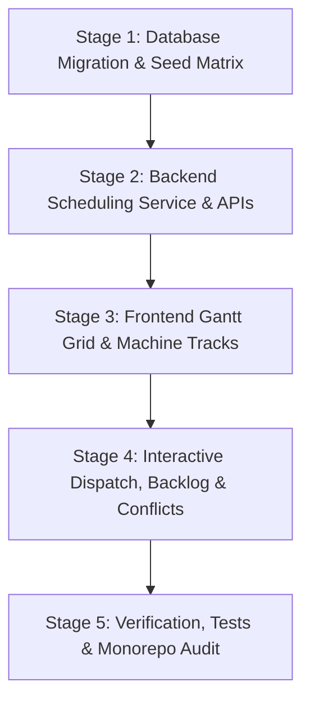

# Implementation Workflow 005: Visual Production Scheduling & Mold Changeover Matrix (Epic 10)

**Status:** PROPOSED PLAN — READY FOR STAGED EXECUTION  
**Target Completion:** Phase 6 / Epic 10 (Interactive Gantt Timeline, Dynamic Mold Changeover Calculations, Machine Capability & Tonnage Matching, Tooling Conflict Resolution, and Unscheduled Order Dispatch)  
**References:**
- Product Requirements: [PRD.md](file:///home/ughway/Debiancode/Myprojects/Manufacturing-Execution-System/.agent-knowledge/dynamic/docs/dev/PRD.md)
- Architecture Plan: [ARCHITECTURE.md](file:///home/ughway/Debiancode/Myprojects/Manufacturing-Execution-System/.agent-knowledge/dynamic/docs/dev/sdd/ARCHITECTURE.md)
- Database Schema: [DATABASE.md](file:///home/ughway/Debiancode/Myprojects/Manufacturing-Execution-System/.agent-knowledge/dynamic/docs/dev/sdd/DATABASE.md)
- Machine Data Dictionary: [MES-MACHINE-DATA-DICTIONARY.md](file:///home/ughway/Debiancode/Myprojects/Manufacturing-Execution-System/docs/notes/MES-MACHINE-DATA-DICTIONARY.md)

---

## 1. Executive Summary & Scheduling Architecture

In high-volume plastic injection molding, capital machinery (injection molding machines ranging from 150T to 500T clamping force) and precision tooling (multi-cavity molds costing tens of thousands of dollars) are the factory's primary constraints. Running machines inefficiently or misallocating molds creates severe bottlenecks:
1. **Unplanned Mold Clamping Incompatibilities**: Attempting to mount a heavy 500-ton mold onto a 150-ton machine leads to clamp damage, tie-bar overload, and safety interlock halts.
2. **Excessive Changeover Deadtime**: Swapping molds indiscriminately causes hours of wasted downtime for mold unmounting, crane transport, hydraulic clamp adjustment, water line hookup, and barrel temperature purge/stabilization.
3. **Tooling Collisions**: The same physical mold cannot run simultaneously on two separate machines.
4. **Disjointed Execution**: Planners currently lack a unified timeline that connects scheduled orders with real-time machine run telemetry.

**Implementation Workflow 005** establishes the **Visual Production Scheduling & Dispatch Engine (Epic 10)**. It introduces an interactive, multi-horizon Gantt dispatch board across all 10 injection molding machines, automated transition time computation via `MoldChangeover`, physical mold collision detection, and seamless one-click order dispatch to shop floor operators.

```text
 ┌────────────────────────────────────────────────────────────────────────────────────────────────────────┐
 │                              PRODUCTION SCHEDULING ENGINE ARCHITECTURE                                │
 └───────────────────────────────────────────────────┬────────────────────────────────────────────────────┘
                                                     │
                     ┌───────────────────────────────┴───────────────────────────────┐
                     ▼                                                               ▼
       ┌───────────────────────────┐                                   ┌───────────────────────────┐
       │   Unscheduled Backlog     │                                   │   Tooling & Capabilities  │
       │   - DRAFT / RELEASED POs  │                                   │   - Machine Clamping Tons │
       │   - Priority & Due Dates  │                                   │   - Mold Compatibility    │
       │   - Target Quantities     │                                   │   - Cavity Multipliers    │
       └─────────────┬─────────────┘                                   └─────────────┬─────────────┘
                     │                                                               │
                     └───────────────────────────────┬───────────────────────────────┘
                                                     │
                                                     ▼
                                      ┌─────────────────────────────┐
                                      │   Scheduling Engine Core    │
                                      │   (SchedulingService)       │
                                      │   - Tonnage Validation      │
                                      │   - Tooling Conflict Guard  │
                                      │   - Mold Changeover Calc    │
                                      │   - Runtime Estimator       │
                                      └──────────────┬──────────────┘
                                                     │
                         ┌───────────────────────────┴───────────────────────────┐
                         ▼                                                       ▼
           ┌───────────────────────────┐                           ┌───────────────────────────┐
           │   Timeline Gantt Stream   │                           │ Changeover Matrix Manager │
           │   - Multi-Machine Tracks  │                           │ - Setup Time (min)        │
           │   - Shift/Day/Week Views  │                           │ - Purge Time (min)        │
           │   - Setup / Run Blocks    │                           │ - Temperature Delta Guard │
           └─────────────┬─────────────┘                           └─────────────┬─────────────┘
                         │                                                       │
                         └───────────────────────────┬───────────────────────────┘
                                                     │
                                                     ▼
                                      ┌─────────────────────────────┐
                                      │   Frontend Interactive HMI  │
                                      │   (SchedulingView.tsx)      │
                                      │   - Drag & Drop Dispatch    │
                                      │   - Conflict Alert Badges   │
                                      │   - Live Actuals Overlay    │
                                      │   - Order Release Gate      │
                                      └─────────────────────────────┘
```

---

## 2. Technical Calculations & Business Logic

### 2.1 Planned Runtime Estimation Formula
The estimated run duration $\Delta T_{\text{run}}$ for an injection molding production order is derived from part target quantity $Q$, mold cavity count $C$, product ideal cycle time $t_{\text{cycle}}$ (in seconds), and an anticipated scrap allowance factor $S$ (standard 2% default):

$$\Delta T_{\text{run}} = \left( \frac{Q \times (1 + S)}{C} \right) \times t_{\text{cycle}} \quad \text{[seconds]}$$

$$\text{Planned Duration (Hours)} = \frac{\Delta T_{\text{run}}}{3600}$$

*Example*: For $Q = 10{,}000$ parts, a 4-cavity mold ($C = 4$), standard cycle time $t_{\text{cycle}} = 24.0\text{ s}$, and $S = 0.02$:
$$\text{Total Shots Required} = \frac{10{,}000 \times 1.02}{4} = 2{,}550 \text{ shots}$$
$$\text{Run Duration} = 2{,}550 \times 24.0\text{ s} = 61{,}200\text{ s} \approx 17.0\text{ hours}$$

### 2.2 Mold Changeover Matrix Calculation
When Order $B$ follows Order $A$ on the same machine $M$:
- **Case 1: Same Mold ($\text{Mold}_A = \text{Mold}_B$)**:
  $$\text{Changeover Duration} = 0 \text{ minutes}$$
- **Case 2: Different Molds ($\text{Mold}_A \neq \text{Mold}_B$)**:
  The system queries `mold_changeovers` matching `(from_mold_id, to_mold_id)`:
  $$\Delta T_{\text{changeover}} = t_{\text{setup}} + t_{\text{purge}} + t_{\text{temp\_stabilization}}$$
  If no explicit pairwise rule exists, a fallback standard heuristic is applied:
  $$\text{Default Setup} = 45\text{ min}, \quad \text{Default Purge} = 15\text{ min} \implies 60\text{ min total}$$

### 2.3 Physical Constraint & Conflict Validation Rules
1. **Rule 1: Machine Clamping Force Match (`TONNAGE_MISMATCH`)**:
   $$F_{\text{clamping, machine}} \ge F_{\text{clamping, mold\_req}}$$
   *Enforcement*: A 500-ton mold cannot be scheduled on `IMM-01` (150T). The engine rejects or flags the assignment with a critical compatibility alert.
2. **Rule 2: Tooling Single-Presence Guarantee (`TOOLING_COLLISION`)**:
   $$\forall \text{ Orders } i, j \text{ where } \text{Mold}_i = \text{Mold}_j \text{ and } \text{Machine}_i \neq \text{Machine}_j:$$
   $$[T_{\text{start}, i}, T_{\text{end}, i}] \cap [T_{\text{start}, j}, T_{\text{end}, j}] = \emptyset$$
   *Enforcement*: If an overlap occurs, both blocks display a collision badge and warn the planner prior to releasing orders.
3. **Rule 3: Machine Overlap Guard (`MACHINE_SCHEDULE_COLLISION`)**:
   A machine cannot run two orders or two changeovers concurrently.
4. **Rule 4: Material Availability Warning (`RESIN_STOCK_GUARD`)**:
   Cross-references scheduled order resin requirement with current `material_lots` inventory. If available stock $< Q \times \text{partWeightGrams}$, a material shortage warning is displayed.

---

## 3. Database Schema & Model Expansion

### 3.1 `ProductionOrder` Schema Extensions
Add dedicated scheduling target fields to `ProductionOrder` in `backend/prisma/schema.prisma`:

```prisma
model ProductionOrder {
  // Existing fields
  id               String    @id @default(uuid())
  orderNumber      String    @unique @map("order_number") @db.VarChar(50)
  productId        String    @map("product_id")
  targetQuantity   Int       @map("target_quantity")
  packedQuantity   Int       @default(0) @map("packed_quantity")
  status           String    @default("DRAFT") @db.VarChar(30) // DRAFT, SCHEDULED, RELEASED, IN_PROGRESS, COMPLETED, CANCELLED
  plannedStartTime DateTime  @map("planned_start_time")
  actualStartTime  DateTime? @map("actual_start_time")
  actualEndTime    DateTime? @map("actual_end_time")
  createdAt        DateTime  @default(now()) @map("created_at")

  // New Scheduling Specific Fields
  plannedEndTime   DateTime? @map("planned_end_time")
  assignedMachineId String?   @map("assigned_machine_id")
  assignedMoldId    String?   @map("assigned_mold_id")
  priority         Int       @default(3) @map("priority") // 1: Urgent/Rush, 2: High, 3: Normal, 4: Low
  sequenceOrder    Int       @default(0) @map("sequence_order") // Relative queue priority on machine
  schedulingNotes  String?   @map("scheduling_notes") @db.VarChar(255)

  // Relations
  product         Product              @relation(fields: [productId], references: [id], onUpdate: NoAction, onDelete: NoAction)
  assignedMachine Machine?             @relation("MachineScheduledOrders", fields: [assignedMachineId], references: [id], onUpdate: NoAction, onDelete: SetNull)
  assignedMold    Mold?                @relation("MoldScheduledOrders", fields: [assignedMoldId], references: [id], onUpdate: NoAction, onDelete: SetNull)
  runs            ProductionRun[]
  operationSteps  OrderOperationStep[]

  @@index([assignedMachineId, plannedStartTime], name: "idx_po_machine_schedule")
  @@index([assignedMoldId], name: "idx_po_assigned_mold")
  @@map("production_orders")
}
```

### 3.2 Machine & Mold Relations
Update `Machine` and `Mold` models to reflect reverse relations:
- `Machine.scheduledOrders`: `ProductionOrder[] @relation("MachineScheduledOrders")`
- `Mold.scheduledOrders`: `ProductionOrder[] @relation("MoldScheduledOrders")`

---

## 4. Backend Service Architecture (`SchedulingModule`)

Create a dedicated NestJS module under `backend/src/modules/scheduling/`:

```text
backend/src/modules/scheduling/
├── dto/
│   ├── schedule-order.dto.ts
│   ├── reschedule-slot.dto.ts
│   ├── upsert-changeover.dto.ts
│   └── schedule-query.dto.ts
├── services/
│   ├── scheduling.service.ts
│   └── scheduling.service.spec.ts
├── scheduling.controller.ts
└── scheduling.module.ts
```

### 4.1 REST API Endpoint Specifications

| Method | Endpoint | Description | Auth Roles |
|---|---|---|---|
| `GET` | `/api/v1/scheduling/timeline` | Returns scheduled and active blocks per machine for the query window (`startDate`, `endDate`), including computed changeovers and conflict warnings. | Planner, Supervisor, Admin, Management |
| `GET` | `/api/v1/scheduling/backlog` | Returns unscheduled orders (`status: 'DRAFT'`) and pending unassigned orders. | Planner, Supervisor, Admin |
| `POST` | `/api/v1/scheduling/orders/:id/schedule` | Assigns an order to a machine, calculates changeover and end time, checks conflicts, and sets status to `SCHEDULED`. | Planner, Admin |
| `PATCH` | `/api/v1/scheduling/orders/:id/reschedule` | Moves an order to a new start time or different machine with timeline recalculation. | Planner, Admin |
| `POST` | `/api/v1/scheduling/orders/:id/unschedule` | Removes machine assignment and reverts order back to `DRAFT`. | Planner, Admin |
| `GET` | `/api/v1/scheduling/changeovers` | Returns all mold changeover transition matrix rules. | Planner, Maintenance, Admin |
| `PUT` | `/api/v1/scheduling/changeovers` | Creates or updates a pairwise changeover rule `(fromMoldId, toMoldId, setupMinutes, purgeMinutes)`. | Planner, Maintenance, Admin |
| `POST` | `/api/v1/scheduling/auto-sequence/:machineId` | Optimizes the machine's queued orders using mold family grouping to minimize setup downtime. | Planner, Admin |

### 4.2 Timeline Payload Contract
```typescript
export interface TimelineMachineRow {
  machineId: string;
  machineCode: string;
  machineName: string;
  clampingForceTons: number;
  currentStatus: string;
  blocks: TimelineBlock[];
}

export type TimelineBlockType = 'PRODUCTION_ORDER' | 'ACTIVE_RUN' | 'MOLD_CHANGEOVER';

export interface TimelineBlock {
  id: string;
  blockType: TimelineBlockType;
  orderId?: string;
  orderNumber?: string;
  productName?: string;
  moldId?: string;
  moldCode?: string;
  startTime: string; // ISO 8601
  endTime: string;   // ISO 8601
  durationMinutes: number;
  status: string;
  progressPercent?: number;
  targetQuantity?: number;
  producedQuantity?: number;
  conflicts?: Array<{
    type: 'TONNAGE_MISMATCH' | 'TOOLING_COLLISION' | 'MACHINE_OVERLAP';
    severity: 'WARNING' | 'CRITICAL';
    message: string;
  }>;
}
```

---

## 5. Frontend HMI Architecture (`SchedulingView.tsx`)

Implement the UI under `frontend/src/components/scheduling/` conforming strictly to Atlassian Design System tokens in [`DESIGN.md`](file:///home/ughway/Debiancode/Myprojects/Manufacturing-Execution-System/DESIGN.md):

### 5.1 Component Structure
```text
frontend/src/components/scheduling/
├── SchedulingView.tsx          # Main container with toolbar, horizon switcher, and backlog drawer
├── GanttTimelineBoard.tsx      # SVG / Flexbox multi-row horizontal Gantt grid
├── TimelineMachineTrack.tsx    # Individual machine row with time slots and snap points
├── TimelineOrderBlock.tsx      # Interactive production order block (draggable / clickable)
├── TimelineChangeoverBlock.tsx # Diagonal striped block representing mold changeover / purge
├── UnscheduledBacklogDrawer.tsx# Right-side drawer of unscheduled orders ready for dispatch
├── MoldChangeoverModal.tsx     # Matrix editor for setup & purge minutes between molds
└── ScheduleOrderModal.tsx      # Manual scheduling dialog with machine & mold picker
```

### 5.2 Interactive Features
1. **Horizon Controls**:
   - `Shift View`: 8 hours with hour columns, ideal for shift supervisors.
   - `Day View`: 24 hours with 2-hour columns.
   - `Week View`: 7 days with date columns, ideal for long-range planning.
   - Jump to `Today / Now` button with a red vertical line showing real-time current timestamp.
2. **Atlassian Token Visual System**:
   - Production block (Normal): `bg-[#E9F2FE] border border-[#8FB8F6] text-[#123263]`.
   - Production block (Urgent/Rush): `bg-[#FFF0B5] border border-[#FFE380] text-[#172B4D] font-bold`.
   - Active Run: `bg-[#EFFFD6] border border-[#6A9A23] text-[#37471F]` with live pulsing indicator.
   - Changeover Block: Diagonal pattern with `bg-[#FFF5DB] border-dashed border-[#E06C00] text-[#693200]`.
   - Conflict Badge: Pulsing alert badge `bg-[#C9372C] text-white` with hover tooltip explaining the collision.
3. **One-Click Dispatch Workflow**:
   - When a planner is satisfied with the schedule, clicking **"Release to Shop Floor"** automatically transitions the order to `RELEASED`, allowing the operator on `IMM-01` to initiate the run immediately.

---

## 6. Granular Stage-by-Stage Implementation Plan



### Stage 1: Database Migration & Seed Matrix
- Update `backend/prisma/schema.prisma` with `assignedMachineId`, `assignedMoldId`, `plannedEndTime`, `priority`, and `sequenceOrder` on `ProductionOrder`.
- Seed realistic `MoldChangeover` pairs in `backend/prisma/seed.ts` for all 4 demo molds (Bumper, Handle, Lens, Medical Housing) with setup times (30 to 60 mins).
- Execute `prisma db push` and `prisma db seed` against MS SQL Server.

### Stage 2: Backend Scheduling Core & REST APIs
- Create `SchedulingModule`, `SchedulingService`, and `SchedulingController`.
- Implement runtime projection formula, conflict detection algorithms (tonnage, mold collision, machine overlap), and changeover lookups.
- Implement comprehensive unit tests (`scheduling.service.spec.ts`) validating tonnage rejection, tooling collision detection, and changeover calculation.

### Stage 3: Frontend Gantt Board & Machine Tracks
- Create `frontend/src/components/scheduling/SchedulingView.tsx` and register in [`Sidebar.tsx`](file:///home/ughway/Debiancode/Myprojects/Manufacturing-Execution-System/frontend/src/components/layout/Sidebar.tsx) under `Execution & routing`.
- Build `GanttTimelineBoard.tsx` with responsive horizontal tracks for all 10 machines, sticky machine label column, time axis headers, and now-indicator.
- Render `TimelineOrderBlock.tsx` and `TimelineChangeoverBlock.tsx` with accurate positioning based on start/end timestamps.

### Stage 4: Interactive Dispatch, Backlog Drawer & Conflict Alerts
- Implement `UnscheduledBacklogDrawer.tsx` allowing planners to pick and schedule backlog orders.
- Implement conflict warning tooltips displaying exact reasons (`"Tooling Collision: Mold MOLD-01 is concurrently assigned to IMM-02"`).
- Implement `ScheduleOrderModal.tsx` and `MoldChangeoverModal.tsx` for manual matrix adjustment.
- Add quick action: **"Release Order"** directly from timeline block.

### Stage 5: Verification, Accessibility Audit & Delivery
- Run `pnpm lint` (`oxlint`) ensuring 0 warnings and 0 errors.
- Run `pnpm --filter backend test` ensuring all unit tests pass.
- Run `pnpm --filter frontend build` verifying TypeScript types and Vite bundle compilation.
- Test visual Gantt interactions in live browser with Playwright.
- Document completion report under `.agent-knowledge/dynamic/reports/tasks/`.

---

## 7. Acceptance Criteria & Test Verification Matrix

| # | Test Scenario | Expected Outcome | Verification Method |
|---|---|---|---|
| 1 | **Runtime Calculation** | An order for 5,000 parts with 2-cavity mold and 20s cycle time calculates planned duration $\approx 14.17$ hours. | Backend Unit Test |
| 2 | **Changeover Calculation** | Scheduling different molds sequentially inserts calculated `setupMinutes + purgeMinutes` block between orders. | Backend Unit Test |
| 3 | **Tonnage Mismatch Prevention** | Scheduling a mold requiring >350T on `IMM-01` (150T) returns a `TONNAGE_MISMATCH` conflict warning. | Backend Unit Test & UI Badge |
| 4 | **Tooling Collision Guard** | Scheduling the same mold on two different machines during overlapping hours triggers `TOOLING_COLLISION`. | Backend Unit Test & UI Alert |
| 5 | **Gantt Timeline Rendering** | All 10 machines display chronological scheduled orders and changeover slots across Shift, Day, and Week views. | Playwright Browser Test |
| 6 | **Unscheduled Backlog Dispatch** | Planners can schedule orders directly from backlog drawer to an available machine slot. | UI & API Integration |
| 7 | **WCAG Accessibility & ADS** | No font sizes $<12\text{px}$, form labels associated with controls, and Atlassian Design System tokens applied. | Oxlint & Code Audit |
| 8 | **Monorepo Health** | `pnpm lint` passes with 0 warnings, 0 errors; full build clean. | CI / CLI Audit |
