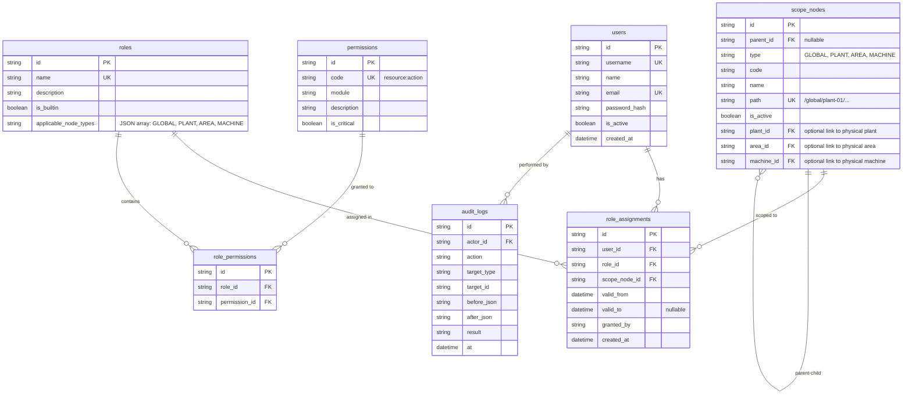
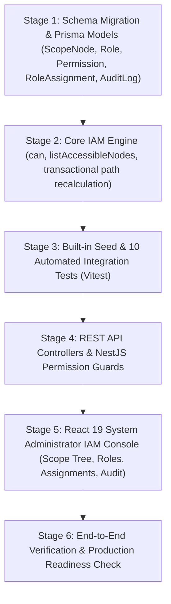

# Implementation Workflow 015: Enterprise Hierarchical IAM with Scoped RBAC and Materialized Scope Tree

> **Status:** `PROPOSED PLAN — READY FOR STAGED EXECUTION`  
> **Target Outcome:** Comprehensive Enterprise IAM (Identity & Access Management) module for multi-plant manufacturing execution, featuring Materialized Path Scope Tree (`GLOBAL -> PLANT -> AREA -> MACHINE`), Scoped Role Assignments with Downward Inheritance, Segment-Boundary Safe Prefix Matching, Centralized System Administrator Super-User Authority, Built-in Canonical Roles, High-Performance `can()` Evaluation Engine, REST API Suite, and Complete Audit Trail.  
> **Owner:** MES Core Team & Architecture  
> **References:**
> - User Specification on Enterprise IAM & Scoped RBAC for Multi-Plant Injection Molding (November 1, 2026)
> - `.agent-knowledge/dynamic/docs/dev/sdd/ARCHITECTURE.md` — ISA-95 Hybrid Work Center & Boundaries
> - `.agent-knowledge/dynamic/docs/dev/sdd/AUTHORIZATION.md` — Scoped RBAC Authorization Model
> - `.agent-knowledge/dynamic/docs/dev/sdd/SECURITY.md` — Security Baselines, Authentication & Token Strategy
> - `.agent-knowledge/dynamic/workflows/014-production-calendar-shift-schedule-and-realistic-oee-seed.md` — Multi-Plant Calendar & Shift Models

---

## 1. Executive Summary & Problem Context

In industrial multi-plant manufacturing (e.g. PT Xyz operating Plant 01 in Cikarang and Plant 02 in Karawang), access management faces distinct operational challenges that standard SaaS RBAC fails to address:

1. **Machine Code Collision Across Plants:** Both Plant 01 and Plant 02 can have an injection molding machine named `IMM-02`. Access control cannot rely on flat machine codes; it strictly requires fully-qualified hierarchical scope paths (`/global/plant-01/inj-mold/imm-02/` vs `/global/plant-02/inj-mold/imm-02/`).
2. **Preventing Role Explosion:** Many junior systems create roles like `Operator_Plant01_HallA` and `Operator_Plant02_HallA`. This causes explosive role duplication. In this architecture, roles remain canonical (`Operator`, `Supervisor`, `Plant Manager`), while spatial scope attaches exclusively to the **Role Assignment** (`User -> Role -> ScopeNode`).
3. **High-Performance Inheritance via Materialized Paths:** Downward inheritance (a Plant Manager automatically holding rights over all areas and machines within that plant) is evaluated in $O(1)$ string prefix matching on a materialized path, eliminating costly recursive CTE database queries on high-frequency API endpoints.
4. **Segment Boundary Safety:** Naive prefix matching using raw `LIKE '/plant01%'` causes security breaches where permissions for `/plant01` leak to `/plant010`. Enforcing trailing slashes (`/plant01/`) guarantees strict segment boundary isolation.
5. **Centralized Administration:** All role definitions, scope nodes, and user assignments are managed exclusively by System Administrators. In line with requested operational policy, System Administrator acts as a **Global Super-User**, holding full access across both administrative (`iam:*`, `scope:*`) and operational production domains (`workorder:*`, `production:*`, `quality:*`).

```text
                                    ┌─────────────────────────────────────────────────────────┐
                                    │               ENTERPRISE GLOBAL SCOPE                   │
                                    │                       /global/                          │
                                    │           [Role: System Administrator]                  │
                                    └───────────────────────────┬─────────────────────────────┘
                                                                │
                                ┌───────────────────────────────┴───────────────────────────────┐
                                ▼                                                               ▼
 ┌─────────────────────────────────────────────────────────────┐ ┌─────────────────────────────────────────────────────────────┐
 │                    PLANT 01 (/global/plant-01/)             │ │                    PLANT 02 (/global/plant-02/)             │
 │                     [Role: Plant Manager]                   │ │                     [Role: Plant Manager]                   │
 └──────────────────────────────┬──────────────────────────────┘ └──────────────────────────────┬──────────────────────────────┘
                                │                                                               │
        ┌───────────────────────┴───────────────────────┐               ┌───────────────────────┴───────────────────────┐
        ▼                                               ▼               ▼                                               ▼
┌───────────────────────────────┐       ┌───────────────────────────────┐       ┌───────────────────────────────┐       ┌───────────────────────────────┐
│     AREA 1: FIN-INSP          │       │     AREA 2: INJ-MOLD          │       │     AREA 1: FIN-INSP          │       │     AREA 2: INJ-MOLD          │
│ /global/plant-01/fin-insp/    │       │ /global/plant-01/inj-mold/    │       │ /global/plant-02/fin-insp/    │       │ /global/plant-02/inj-mold/    │
│      [Role: Supervisor]       │       │      [Role: Supervisor]       │       │      [Role: Supervisor]       │       │      [Role: Supervisor]       │
└───────────────┬───────────────┘       └───────────────┬───────────────┘       └───────────────┬───────────────┘       └───────────────┬───────────────┘
                │                                       │                                       │                                       │
        ┌───────┴───────┐                       ┌───────┴───────┐                       ┌───────┴───────┐                       ┌───────┴───────┐
        ▼               ▼                       ▼               ▼                       ▼               ▼                       ▼               ▼
┌───────────────┐┌───────────────┐      ┌───────────────┐┌───────────────┐      ┌───────────────┐┌───────────────┐      ┌───────────────┐┌───────────────┐
│    ATM-01     ││    DBR-01     │      │    IMM-01     ││    IMM-02     │      │    ATM-02     ││    DBR-02     │      │    IMM-02     ││    IMM-03     │
│   (Machine)   ││   (Machine)   │      │   (Machine)   ││   (Machine)   │      │   (Machine)   ││   (Machine)   │      │   (Machine)   ││   (Machine)   │
└───────────────┘└───────────────┘      └───────────────┘└───────────────┘      └───────────────┘└───────────────┘      └───────────────┘└───────────────┘
```

---

## 2. Objective, Scope, and Design Decisions

### Primary Objective

Deliver an enterprise-grade, ISA-95 compliant IAM module with scoped RBAC, dynamic materialized path tree management, built-in injection molding role templates, transactional hierarchy path updates, high-throughput permission verification engine `can()`, comprehensive REST API endpoints, and a React 19 System Administrator visual management console.

### Key Design Decisions

1. **Scoped RBAC on Assignment:** Scope attaches to `RoleAssignment`, NEVER to `Role`.
2. **Centralized Administration:** All IAM mutations are restricted to `System Administrator`. No delegation to Plant Managers.
3. **Super-User System Administrator:** System Administrator holds full access across administrative and operational permissions globally.
4. **Union of Effective Permissions:** Users can hold multiple roles at different or identical nodes. Effective permissions = union of all active matching assignments covering the target node.
5. **Strict Downward Inheritance:** An assignment on a parent node automatically covers all descendant nodes. Access never inherits upward or sideways.
6. **Trailing Slash Path Convention:** Paths are dynamically materialized with trailing slashes (e.g. `/global/plant-01/inj-mold/imm-01/`). SQL prefix queries use `WHERE :targetPath LIKE CONCAT(scope_nodes.path, '%')`, completely eliminating segment boundary collision bugs (`/plant01/` vs `/plant010/`).
7. **Developer-Governed Permission Catalog:** Permission catalog is maintained strictly in code and database migrations. System Administrators cannot create raw permissions, only compose roles from existing catalog entries.
8. **Allow-Only Model:** Default is strict deny. No explicit deny rules.
9. **No Dual-Control Prompt:** Critical permissions (`recipe:edit`, `quality:disposition`, `equipment:override`) execute cleanly without redundant password prompts, relying on authenticated identity, assignment validity, and complete audit trail.
10. **Last SysAdmin Protection:** System rejects any delete, demote, or deactivate operation that would leave zero active System Administrators.

---

## 3. Data Architecture (`schema.prisma` & Database Model)

### 3.1 Entity Relationship Diagram



### 3.2 Prisma Schema Additions

```prisma
enum ScopeNodeType {
  GLOBAL
  PLANT
  AREA
  MACHINE
}

model ScopeNode {
  id        String        @id @default(uuid())
  parentId  String?       @map("parent_id")
  type      ScopeNodeType
  code      String        @db.VarChar(50)
  name      String        @db.VarChar(150)
  path      String        @unique @db.VarChar(500)
  isActive  Boolean       @default(true) @map("is_active")
  createdAt DateTime      @default(now()) @map("created_at")
  updatedAt DateTime      @default(now()) @updatedAt @map("updated_at")

  // Optional foreign keys to physical master data
  plantId   String?       @map("plant_id")
  areaId    String?       @map("area_id")
  machineId String?       @map("machine_id")

  parent    ScopeNode?    @relation("ScopeTree", fields: [parentId], references: [id], onDelete: NoAction, onUpdate: NoAction)
  children  ScopeNode[]   @relation("ScopeTree")
  roleAssignments RoleAssignment[]

  @@index([parentId], name: "idx_scope_node_parent")
  @@index([path], name: "idx_scope_node_path")
  @@map("scope_nodes")
}

model Role {
  id                  String   @id @default(uuid())
  name                String   @unique @db.VarChar(100)
  description         String?  @db.VarChar(255)
  isBuiltin           Boolean  @default(false) @map("is_builtin")
  applicableNodeTypes String   @default("[\"GLOBAL\",\"PLANT\",\"AREA\",\"MACHINE\"]") @map("applicable_node_types") @db.VarChar(255)
  createdAt           DateTime @default(now()) @map("created_at")
  updatedAt           DateTime @default(now()) @updatedAt @map("updated_at")

  rolePermissions RolePermission[]
  roleAssignments RoleAssignment[]

  @@map("roles")
}

model Permission {
  id          String   @id @default(uuid())
  code        String   @unique @db.VarChar(100) // e.g. "workorder:start"
  module      String   @db.VarChar(50)         // e.g. "production"
  description String?  @db.VarChar(255)
  isCritical  Boolean  @default(false) @map("is_critical")
  createdAt   DateTime @default(now()) @map("created_at")

  rolePermissions RolePermission[]

  @@map("permissions")
}

model RolePermission {
  id           String @id @default(uuid())
  roleId       String @map("role_id")
  permissionId String @map("permission_id")

  role       Role       @relation(fields: [roleId], references: [id], onDelete: Cascade)
  permission Permission @relation(fields: [permissionId], references: [id], onDelete: Cascade)

  @@unique([roleId, permissionId], name: "uq_role_permission")
  @@map("role_permissions")
}

model RoleAssignment {
  id          String    @id @default(uuid())
  userId      String    @map("user_id")
  roleId      String    @map("role_id")
  scopeNodeId String    @map("scope_node_id")
  validFrom   DateTime  @default(now()) @map("valid_from")
  validTo     DateTime? @map("valid_to")
  grantedBy   String    @map("granted_by") @db.VarChar(100)
  createdAt   DateTime  @default(now()) @map("created_at")

  user      User      @relation(fields: [userId], references: [id], onDelete: Cascade)
  role      Role      @relation(fields: [roleId], references: [id], onDelete: Cascade)
  scopeNode ScopeNode @relation(fields: [scopeNodeId], references: [id], onDelete: Restrict)

  @@index([userId, validFrom, validTo], name: "idx_assignment_active")
  @@index([scopeNodeId], name: "idx_assignment_scope")
  @@map("role_assignments")
}
```

---

## 4. Built-in Roles & Permission Catalog

### 4.1 Permission Catalog (Injection Molding MES)

| Module | Permission Code | Description | Critical |
| :--- | :--- | :--- | :---: |
| **IAM** | `iam:role:view` | View role definitions | No |
| **IAM** | `iam:role:manage` | Create, update, and manage roles | No |
| **IAM** | `iam:assignment:view` | View user role assignments | No |
| **IAM** | `iam:assignment:manage` | Assign or revoke roles to users | No |
| **Scope** | `scope:view` | View scope tree hierarchy | No |
| **Scope** | `scope:manage` | Add, update, move, or deactivate scope nodes | No |
| **Audit** | `audit:view` | View system and security audit logs | No |
| **Production** | `workorder:view` | View work orders and dispatching | No |
| **Production** | `workorder:start` | Start production run on equipment | No |
| **Production** | `workorder:stop` | Stop or pause active production run | No |
| **Production** | `workorder:release` | Release scheduled orders to shopfloor | No |
| **Production** | `production:report` | Log cycle production and piece counts | No |
| **Quality** | `quality:inspect` | Record quality sample measurements | No |
| **Quality** | `quality:disposition` | Release or quarantine product lots (Lockout) | **Yes** |
| **Engineering**| `recipe:view` | View molding parameter recipes | No |
| **Engineering**| `recipe:edit` | Modify injection pressure/speed/temp recipes | **Yes** |
| **Engineering**| `equipment:override` | Override safety/maintenance interlock gate | **Yes** |

### 4.2 Canonical Built-in Roles

1. **System Administrator:**
   - **Scope Applicable Types:** `["GLOBAL"]`
   - **Role:** Super-User (Full Catalog: all administrative permissions + all operational permissions).
2. **Plant Manager:**
   - **Scope Applicable Types:** `["PLANT"]`
   - **Permissions:** `workorder:*`, `production:*`, `quality:inspect`, `quality:disposition`, `recipe:view`, `audit:view`, `scope:view`.
3. **Supervisor:**
   - **Scope Applicable Types:** `["AREA"]`
   - **Permissions:** `workorder:view`, `workorder:start`, `workorder:stop`, `production:report`, `quality:inspect`, `recipe:view`, `recipe:edit`, `equipment:override`, `scope:view`.
4. **Operator:**
   - **Scope Applicable Types:** `["AREA", "MACHINE"]`
   - **Permissions:** `workorder:view`, `workorder:start`, `workorder:stop`, `production:report`, `quality:inspect`, `recipe:view`.

---

## 5. Core Evaluation Engine: `can()`, `listAccessibleNodes()`, and Guards

### 5.1 Algorithm for `can(user, permission_code, target_node_id)`

```typescript
export interface CanResult {
  allowed: boolean;
  reason: string;
  matchedAssignments: Array<{
    assignmentId: string;
    roleName: string;
    scopeNodePath: string;
  }>;
}

public async can(
  userId: string,
  permissionCode: string,
  targetNodeId: string,
): Promise<CanResult> {
  const now = new Date();

  // 1. Resolve target node path
  const targetNode = await this.prisma.scopeNode.findUnique({
    where: { id: targetNodeId },
  });
  if (!targetNode || !targetNode.isActive) {
    return { allowed: false, reason: 'Target scope node not found or deactivated', matchedAssignments: [] };
  }

  // 2. Fetch all active assignments for user
  const assignments = await this.prisma.roleAssignment.findMany({
    where: {
      userId,
      validFrom: { lte: now },
      OR: [{ validTo: null }, { validTo: { gte: now } }],
      user: { isActive: true },
      scopeNode: { isActive: true },
    },
    include: {
      role: {
        include: {
          rolePermissions: {
            include: { permission: true },
          },
        },
      },
      scopeNode: true,
    },
  });

  if (!assignments.length) {
    return { allowed: false, reason: 'No active role assignments found for user', matchedAssignments: [] };
  }

  // 3. Filter assignments whose path is an exact segment prefix of targetNode.path
  // Example: targetNode.path = "/global/plant-01/inj-mold/imm-01/"
  // Assignment path "/global/plant-01/" matches!
  // Assignment path "/global/plant-010/" does NOT match!
  const matchedAssignments: CanResult['matchedAssignments'] = [];

  for (const asgn of assignments) {
    const scopePath = asgn.scopeNode.path;
    if (targetNode.path.startsWith(scopePath)) {
      // Check if this assignment's role holds the requested permission
      const hasPermission = asgn.role.rolePermissions.some(
        (rp) => rp.permission.code === permissionCode,
      );
      if (hasPermission) {
        matchedAssignments.push({
          assignmentId: asgn.id,
          roleName: asgn.role.name,
          scopeNodePath: asgn.scopeNode.path,
        });
      }
    }
  }

  if (matchedAssignments.length > 0) {
    return {
      allowed: true,
      reason: `Granted via ${matchedAssignments.length} matching assignment(s)`,
      matchedAssignments,
    };
  }

  return {
    allowed: false,
    reason: `User does not possess permission "${permissionCode}" at target scope "${targetNode.path}"`,
    matchedAssignments: [],
  };
}
```

### 5.2 Transactional Path Recalculation on Node Move

When moving a node or changing its code, all descendant paths must be updated in a single atomic database transaction:

```typescript
public async updateNodeParentOrCode(
  nodeId: string,
  newParentId?: string | null,
  newCode?: string,
): Promise<ScopeNode> {
  return this.prisma.$transaction(async (tx) => {
    const node = await tx.scopeNode.findUniqueOrThrow({ where: { id: nodeId } });
    const oldPath = node.path;

    // Calculate new path
    let newBasePath = '/';
    if (newParentId) {
      const parent = await tx.scopeNode.findUniqueOrThrow({ where: { id: newParentId } });
      newBasePath = parent.path;
    }
    const finalCode = (newCode ?? node.code).toLowerCase();
    const newPath = `${newBasePath}${finalCode}/`;

    // 1. Update the target node
    const updated = await tx.scopeNode.update({
      where: { id: nodeId },
      data: {
        parentId: newParentId !== undefined ? newParentId : node.parentId,
        code: finalCode,
        path: newPath,
      },
    });

    // 2. Update all descendant nodes whose paths start with oldPath
    // SQL Server string replacement
    await tx.$executeRaw`
      UPDATE scope_nodes
      SET path = ${newPath} + SUBSTRING(path, LEN(${oldPath}) + 1, LEN(path))
      WHERE path LIKE ${oldPath + '%'} AND id != ${nodeId}
    `;

    return updated;
  });
}
```

---

## 6. Staged Implementation Plan



### Stage 1: Schema Migration & Prisma Models
- Add `ScopeNodeType` enum and `ScopeNode`, `Role`, `Permission`, `RolePermission`, `RoleAssignment`, `AuditLog` models to `backend/prisma/schema.prisma`.
- Create clean migration script `20261101120000_implement_hierarchical_iam_scope_nodes`.
- Generate Prisma Client and apply DDL migration on Microsoft SQL Server.

### Stage 2: Core IAM Evaluation & Hierarchy Service
- Create `backend/src/modules/iam/iam.service.ts`:
  - `can(user, permission, targetNodeId)`
  - `listAccessibleNodes(user, permission)`
  - `getEffectiveAccess(user, nodeId)`
  - `updateNodeParentOrCode()` with atomic child path updating.
  - In-memory cache with event-driven invalidation.

### Stage 3: Built-in Seed & 10 Automated Tests
- Create `backend/prisma/seed-iam.ts`:
  - Seed 17 canonical permissions.
  - Seed 4 canonical roles (`System Administrator`, `Plant Manager`, `Supervisor`, `Operator`).
  - Seed scope tree for PT Xyz:
    - Root: `/global/`
    - Plant 01: `/global/plant-01/` with areas `fin-insp` and `inj-mold`, machines `ATM-01`, `DBR-01`, `IMM-01`, `IMM-02`.
    - Plant 02: `/global/plant-02/` with areas `fin-insp` and `inj-mold`, machines `ATM-02`, `DBR-02`, `IMM-02`, `IMM-03`.
- Write test file `backend/test/iam-scoped-rbac.spec.ts` covering all 10 mandatory validation scenarios.

### Stage 4: NestJS Guards & REST Controllers
- Implement `@RequirePermission(code)` and `@ResolveScopeNode()` decorators.
- Implement `ScopedPermissionGuard` in NestJS pipeline.
- Implement REST Controllers:
  - `GET /iam/permissions`
  - `GET /iam/roles`, `POST /iam/roles`, `PUT /iam/roles/:id` (with dry-run preview of affected users)
  - `GET /iam/scope-nodes/tree`, `POST /iam/scope-nodes`, `PUT /iam/scope-nodes/:id`, `DELETE /iam/scope-nodes/:id` (soft delete)
  - `GET /iam/assignments`, `POST /iam/assignments`, `DELETE /iam/assignments/:id`
  - `GET /iam/users/:id/effective-access?node_id=...`
  - `POST /iam/check`
  - `GET /iam/audit-log`

### Stage 5: React 19 System Administrator IAM Console
- Add new administrative view module under `/iam` or Settings portal:
  - **Interactive Scope Tree Editor:** Visual expandable tree showing Global $\rightarrow$ Plant $\rightarrow$ Area $\rightarrow$ Machine nodes with active status badges.
  - **Role & Permission Matrix Editor:** Grouped by functional module, with critical badges. Dry-run user count preview on edit.
  - **Assignment Manager:** Multi-plant assignment manager with node picker and validity dates.
  - **Effective Access Inspector:** Debug tool allowing SysAdmins to pick any user and scope node to verify granted permissions.
  - **Audit Log Explorer:** Searchable security event log.

### Stage 6: Verification & Handover
- Run all 32 unit test suites + new IAM unit test suite.
- Run all E2E test suites.
- Perform frontend type check and production build (`tsc -b && vite build`).
- Commit and merge adhering to [GIT.md](file:///.agent-knowledge/static/rules/GIT.md).

---

## 7. Mandatory Automated Test Matrix (10 Scenarios)

The test suite in `backend/test/iam-scoped-rbac.spec.ts` will strictly validate:

| # | Skenario Pengujian | Input Scope / Node | Expected Result | Penjelasan |
| :-: | :--- | :--- | :---: | :--- |
| **1** | **Cross-Area Isolation** | Supervisor di `/global/plant-01/fin-insp/` mencoba `workorder:start` di `ATM-01` vs `IMM-01` | `ATM-01`: **ALLOW**<br>`IMM-01`: **DENY** | Hak akses area fin-insp tidak bocor ke area inj-mold meskipun di plant yang sama. |
| **2** | **Multi-Plant Node Disambiguation** | Operator dengan assignment di `/global/plant-01/inj-mold/imm-01/` | `P1 IMM-01`: **ALLOW**<br>`P1 IMM-02`: **DENY**<br>`P2 IMM-02`: **DENY** | Mesin dengan kode sama (`IMM-02`) di plant berbeda terisolasi sempurna. |
| **3** | **Cross-Plant Manager Isolation** | Plant Manager di `/global/plant-01/` mengakses `/global/plant-02/` | **DENY** | Hak akses plant tidak pernah bocor ke plant lain. |
| **4** | **Union of Multiple Roles** | User memiliki Role Operator + Role Quality Inspector pada node yang sama | **UNION GRANTED** | User mendapatkan gabungan seluruh permission dari kedua role. |
| **5** | **Temporal & Status Invalidation** | Assignment dengan `valid_to` kadaluwarsa atau user dinonaktifkan (`isActive = false`) | **DENY** | Validitas waktu dan status aktif user dievaluasi secara ketat. |
| **6** | **Segment Boundary Safety** | Assignment pada `/global/plant-01/` dievaluasi terhadap `/global/plant-010/` | **DENY** | Trailing slash mencegah kebocoran prefix antar segmen serupa. |
| **7** | **Applicable Node Types Enforcement** | Mencoba meng-assign role Plant Manager pada node bertipe `MACHINE` | **REJECTED (400)** | Integritas tipe node divalidasi saat pembuatan assignment. |
| **8** | **Last Admin Lockout Protection** | Mencoba menonaktifkan atau mencabut role System Administrator terakhir | **REJECTED (400)** | Sistem mencegah hilangnya akses administratif secara mutlak. |
| **9** | **SysAdmin Global Super-User** | System Administrator mengeksekusi `workorder:start` dan `iam:role:manage` di mesin mana pun | **ALLOW** | Sesuai keputusan desain, SysAdmin memiliki akses penuh secara global. |
| **10**| **Audit Log Integrity** | Setiap mutasi role, assignment, dan scope node | **LOGGED** | Baris audit log tercipta dengan `before_json`, `after_json`, `actor_id`, dan timestamp. |

---

## 8. Observable Completion Criteria

1. [ ] Skema database Prisma termigrasi dengan sukses ke Microsoft SQL Server.
2. [ ] Engine `can()` mengevaluasi hak akses dengan latensi $< 2\text{ms}$ (menggunakan in-memory cache dan prefix match).
3. [ ] 10 skenario pengujian otomatis di `iam-scoped-rbac.spec.ts` berstatus `10/10 PASSED`.
4. [ ] Seluruh endpoint produksi terlindungi oleh `ScopedPermissionGuard`.
5. [ ] UI System Administrator di React 19 berfungsi mulus untuk mengelola pohon scope dan user assignments.
6. [ ] Audit log mencatat 100% perubahan IAM tanpa celah.
